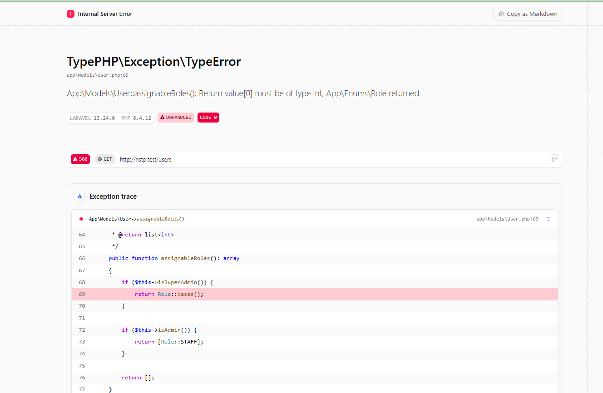
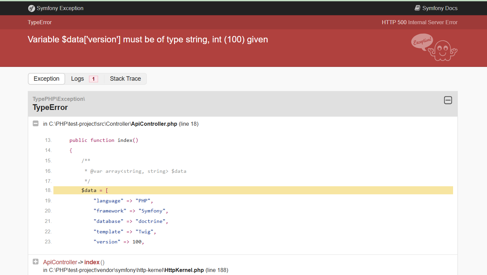
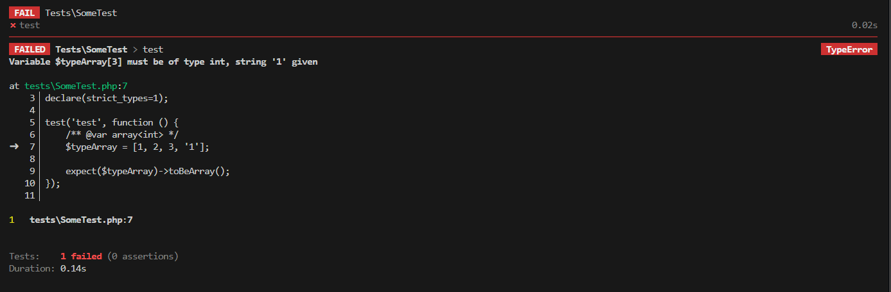

<h1 align="center">TypePHP</h1>

<p align="center">
  <b>No transpilation. No build steps. No C-extensions.<br>
  Drop TypePHP into your existing codebase and let your DocBlocks scream when types fail.</b>
</p>

<p align="center">
	<a href="https://github.com/typephp-php/typephp/actions"></a>
	<a href="https://codecov.io/gh/typephp-php/typephp"></a>
	<a href="https://packagist.org/packages/typephp/typephp"></a>
	<a href="https://packagist.org/packages/typephp/typephp"></a>
	<a href="https://choosealicense.com/licenses/mit/"></a>
	<a href="https://packagist.org/packages/typephp/typephp"></a>
	<a href="https://phpstan.org/"></a>
</p>

---

TypePHP is a Fast transparent, pure-PHP runtime type checker. You don't have to refactor a single line of your codebase, set up complex build toolchains, or compile C-extensions. Simply run your existing code, and TypePHP will enforce your extended PHPDoc contracts (generics, array shapes, `key-of`/`value-of` extractions, and scalar refinements) dynamically at runtime.

Run in **Strict Mode** to throw immediate `TypeError` exceptions, or switch to **Audit Report Mode** to collect all runtime type violations across your test suites and legacy codebases into structured JSON reports without interrupting execution.

**[Read the full TypePHP documentation »](https://typephp.dev/)** | **[Try it online in the Playground »](https://typephp.dev/playground)**

---

## Try It Online

You can test TypePHP directly in your browser without installing anything locally via the **[Interactive WebAssembly Playground](https://typephp.dev/playground)**:

---

## Installation

Install TypePHP as a development dependency via Composer:

```bash
composer require typephp/typephp --dev
```

*Note: TypePHP boots automatically via Composer's autoloader. No service providers, bootstrap edits, or framework configurations are required.*

---

## Quick Start

### 1. Initialize Configuration (Optional)

Generate a default `typephp.php` configuration file in your project root:

```bash
vendor/bin/typephp config:init
```

### 2. Write Standard DocBlocks

Annotate your functions, methods, and classes with standard static analysis DocBlocks:

```php
namespace App\Services;

class PaymentService
{
    /**
     * @param positive-int $amount
     * @param array{gateway: 'stripe'|'paypal', currency: non-empty-string} $options
     * @return non-empty-string
     */
    public function charge(int $amount, array $options): string
    {
        return "Transaction successful";
    }
}
```

### 3. Run Your Application or Tests

If your application runs through an entry point where `require 'vendor/autoload.php'` is declared (such as a web framework's `public/index.php`, CLI commands, or test runners like **Pest** and **PHPUnit**), **TypePHP runs automatically and transparently in the background**.

Simply run your tests or use your local development server (**Laravel**, **Symfony**, **FrankenPHP**, **PHP-FPM**). TypePHP immediately intercepts and enforces all parameter, return, shape, and generic contracts in real time.

---

## Executing Standalone Scripts (CLI Runner)

You can run any standalone PHP script directly with the TypePHP CLI binary:

```bash
vendor/bin/typephp script.php
```

Targeting a file directly with the CLI binary automatically type-checks that file **even if it is not registered in `typephp.php` or falls outside your configured `include` paths**. 

Any secondary files required or included by your script will continue to respect your project's configured `include` and `exclude` paths.

---

## Type-Checking Files Anywhere ("*" Wildcard Glob)

By default, TypePHP checks standard application folders (`src/**`, `app/**`, `tests/**`). To type-check PHP files anywhere in your project root during regular application runs while still respecting your excluded folders, set the `"*"` wildcard glob in `typephp.php`:

```php
// typephp.php
return [
    'include' => [
        '*',
    ],
    'exclude' => [
        'vendor/**',
        'storage/**',
        'var/**',
        'cache/**',
    ],
];
```

---

## Live Diagnostics (Zero Line-Drift)

When a type contract fails, web exception handlers (**Laravel Ignition, Symfony ErrorHandler, Whoops**) and CLI test runners (**Pest, PHPUnit**) highlight **the exact line of code** in your application where the invalid data was passed, with **zero line-drift**:

### Web Framework Trace (Laravel Ignition)
<p align="center">
  
</p>

### Web Framework Trace (Symfony ErrorHandler)
<p align="center">
  
</p>

### CLI Test Runner Trace (Pest PHP)
<p align="center">
  
</p>

---

## See It In Action

### 1. Framework Boundary Protection (Laravel / Symfony)
Prevent dynamic data bugs from leaking into database queries or API responses:

```php
namespace App\Models;

use App\Enums\Role;
use Illuminate\Database\Eloquent\Model;

class User extends Model
{
    /**
     * @return list<int>
     */
    public function assignableRoles(): array
    {
        if ($this->isSuperAdmin()) {
            // Bug! Returns an array of Role Enum instances instead of integers:
            return Role::cases(); 
        }

        return [Role::STAFF->value];
    }
}

// Executing $user->assignableRoles() throws:
// TypePHP\Exception\TypeError: User::assignableRoles(): Return value[0] must be of type int, App\Enums\Role returned
```

### 2. True Runtime Generics with Memory State
Define generic templates and TypePHP tracks their state per object instance in memory using native `\WeakMap`:

```php
/**
 * @template T
 */
class Collection 
{
    /** @param T $item */
    public function add(mixed $item): void { }
}

// Prebind T = User to this specific instance in WeakMap memory
/** @var Collection<User> $users */
$users = new Collection();

$users->add(new User('Alice'));

$users->add(new Product('SKU-100')); 
// Throws TypeError: Argument $item (template T = User) must be of type User, Product given
```

### 3. Array Shapes & Constant Extractions
Enforce strict associative array structures and constant key/value extractions:

```php
namespace App\Services;

use App\Database\DriverManager;

/**
 * @phpstan-type ConnectionParams array{
 *     driver: key-of<DriverManager::DRIVER_MAP>,
 *     driverClass?: value-of<DriverManager::DRIVER_MAP>
 * }
 */
class DatabaseService
{
    /**
     * @param ConnectionParams $params
     */
    public function connect(array $params): void
    {
        // ...
    }
}

$service = new DatabaseService();

$service->connect(['driver' => 'pdo_mysql']);

$service->connect(['driver' => 'pdo_invalid']);
// Throws TypeError: Argument $params['driver'] must be a key of DriverManager::DRIVER_MAP
```

### 4. Zero-Crash Audit & Reporting Mode (CI/CD Quality Gates)
Audit legacy codebases, massive monolithic applications, or staging environments without crashing execution:

```php
// typephp.php
return [
    'on_violation'   => 'report', // 'throw' | 'report' | 'warn'
    'report_file'    => 'var/typephp-report.json',
    'fail_on_report' => true,     // Terminates with exit code 1 at shutdown if violations exist
    'redact_values'  => true,     // Masks raw values for GDPR / HIPAA compliance
];
```

Run your full test suite or application normally, then inspect the formatted violation report directly in your terminal:

```bash
vendor/bin/typephp report
```

```
  TYPEPHP  Violation Audit Report

  • Total Violations: 2
  • Files Affected:   1
  • Report Source:    var/typephp-report.json

  src/Services/OrderService.php
    Line 42    parameter   $amount      expected positive-int, int given
    Line 88    return      return       expected non-empty-string, string given
```

Supports parallel test runners (**ParaTest**, **Pest Parallel**) with automatic process-isolated worker sharding and lock-free report consolidation.

---

## Performance: Unbearably Fast Runtime Enforcement

Runtime type checking in pure PHP shouldn't force you to choose between strictness and speed. TypePHP combines **compile-time AST elimination**, **AST-inlined fast-path guards**, **precompiled opcode plans**, **bitmask template inference**, and **optional O(1) hybrid array sampling** and delivering blazing-fast execution even on the heaviest generic codebases.

### Real-World Stress Benchmark ([`noctud/collection`](https://github.com/noctud/collection))

Tested against `noctud/collection` (**6,928 tests, 12,510 assertions**) this a worst-case, pure-CPU benchmark packed with `@template` inference, variance rules, `WeakMap` reified generics, conditional return types, fluent `self<T>` chains, iterables, and closures:

| Mode | Native PHP (`TYPEPHP_DISABLE=true`) | Early TypePHP | TypePHP Now | Wall-Time Speedup | Overhead Eliminated |
| --- | --- | --- | --- | --- | --- |
| **Sequential (`phpunit`)** | `00:06.554` (`82 MB`) | `02:41.013` (`108 MB`) | `00:29.440` (`128 MB`) | **5.47× faster** | **−85.2%** (`154.5s` → `22.9s`) |
| **Parallel (`paratest -p4`)** | `00:02.001` (`62 MB`) | `01:26.168` (`62 MB`) | `00:07.780` (`62 MB`) | **11.08× faster** | **−93.1%** (`84.2s` → `5.8s`) |

Running full runtime generics and PHPDoc contract enforcement across nearly 7,000 collection tests completes in **under 8 seconds** in parallel and adding less than **6 seconds** over raw native PHP.

### How TypePHP Stays Fast
* **Compile-Time Static Elimination:** Provably satisfied contracts (literals, trusted unmutated parameters, constants, exact non-generic instantiations) are eliminated during AST transformation and costing **0 ns** at runtime.
* **AST-Inlined Guards & Disk Caching:** Transformed files are cached to disk (and OPcache-ready) with inline `isset()` short-circuits so unconstrained or non-contracted methods skip runtime calls entirely.
* **Precompiled Opcode Plans & Flat Call Frames:** Parameter, return, `class-string<T>`, and generic iterable checks execute against precompiled integer opcodes, bitmasks, and flat O(1) frame arrays rather than re-interpreting DocBlock ASTs.
* **Configurable Array Strategy (`full` vs `hybrid`):** Use `'array_validation' => 'full'` for 100% exhaustive O(n) scans, or switch to `'hybrid'` for Beartype-inspired O(1) boundary + random sampling on massive arrays (`> 128` items).

---

## Documentation

All the documentation lives on the **[typephp.dev](https://typephp.dev/)** website:

* [Interactive Playground](https://typephp.dev/playground)
* [Getting Started & Installation Guide](https://typephp.dev/docs/getting-started/installation)
* [Quick Start Guide](https://typephp.dev/docs/getting-started/quick-start)
* [Configuration Guide](https://typephp.dev/docs/getting-started/configuration)
* [Audit Reporting & CI/CD Gates](https://typephp.dev/docs/getting-started/audit-reporting)
* [CLI Commands Reference](https://typephp.dev/docs/getting-started/cli-commands)
* [Runtime Generics (Flagship)](https://typephp.dev/docs/generics/basics-and-bounds)
* [Enforcement Boundaries: Function Contracts](https://typephp.dev/docs/core-concepts/function-contracts)
* [Supported Types: Arrays & Shapes](https://typephp.dev/docs/supported-types/arrays-and-shapes)
* [Architecture: How It Works](https://typephp.dev/docs/advanced/how-it-works)
* [Official Blog & Announcements](https://typephp.dev/blog/)
* [Troubleshooting & FAQ](https://typephp.dev/docs/troubleshooting)

---

## Credits & Special Thanks

TypePHP stands on the shoulders of giants. It simply would not exist without these foundational tools and supporters of the PHP ecosystem:

* **[PHPStan](https://phpstan.org/) & [`phpstan/phpdoc-parser`](https://github.com/phpstan/phpdoc-parser)** (created by [Ondřej Mirtes](https://github.com/ondrejmirtes) and contributors):
  A massive and sincere debt of gratitude is owed to the PHPStan team. Beyond establishing the modern type standard in PHP, `phpstan/phpdoc-parser` is the parsing powerhouse behind TypePHP. It enables TypePHP to tokenize, parse, and evaluate complex type theory including reified generics (`@template`), conditional types, intersection/union types, DNF, array shapes, and variance directly at runtime.
* **[`nikic/php-parser`](https://github.com/nikic/PHP-Parser)** (created by [Nikita Popov](https://github.com/nikic)):
  The gold standard for PHP abstract syntax tree (AST) parsing and code manipulation. It powers TypePHP's transparent stream wrapper interception, format-preserving AST transformations, and zero line-drift instrumentation.
* **[Blackfire](https://www.blackfire.io/)**:
  A huge thank you to **Blackfire** for generously providing a **free 1-year open-source subscription** for TypePHP. Blackfire's deterministic call-graph and memory profiling made it possible to hunt down hot-path bottlenecks and achieve up to an **11× speedup** on generics-heavy workloads.
* **[`php-spx`](https://github.com/NoiseByNorthwest/php-spx)**:
  Many thanks to the `php-spx` PHP profiling extension—its lightweight flamegraphs, flat execution profiles, and built-in web UI were instrumental in pinpointing tight-loop overhead and tuning TypePHP's runtime engine.

---

## Inspiration

TypePHP is conceptually inspired by Python's [Beartype](https://github.com/beartype/beartype) and [Typeguard](https://github.com/agronholm/typeguard), bringing transparent runtime type enforcement for type annotations to the PHP ecosystem without decorators or attributes.

---

## Sponsors

Want to support the open-source development and maintenance of TypePHP? [Sponsor me on GitHub »](https://github.com/sponsors/rcalicdan)

---

## Contributing

Any contributions are welcome. Feel free to open issues or submit pull requests on GitHub.

---

## License

TypePHP is open-source software licensed under the [MIT License](https://choosealicense.com/licenses/mit/).